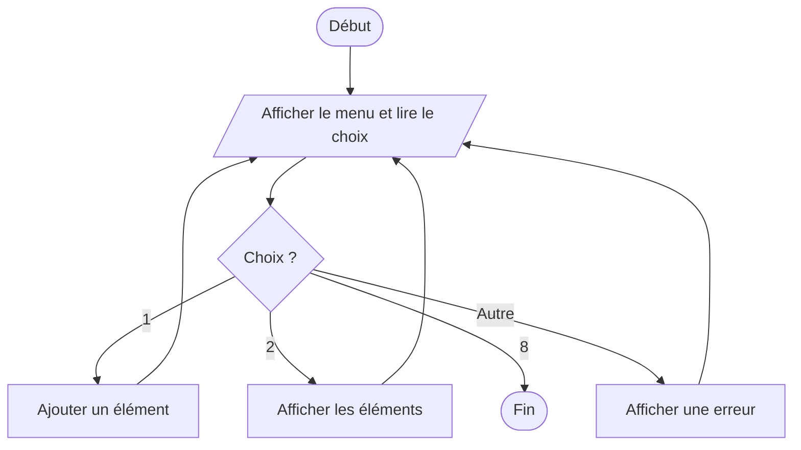
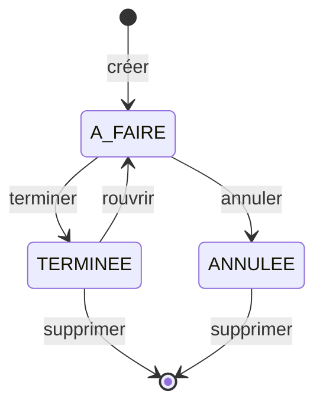

# Avant de coder — représenter le flow

Un **flow** décrit le chemin suivi par un programme avant d'écrire son code.
Il permet de rendre visibles :

- les entrées et les sorties ;
- l'ordre des actions ;
- les décisions et leurs différentes branches ;
- les boucles ;
- les états possibles ;
- les erreurs à traiter.

Le diagramme n'a pas besoin de montrer chaque ligne de Python. Il doit expliquer
le comportement du programme assez clairement pour permettre à une autre
personne de l'implémenter.

## Pourquoi commencer par un flow ?

```text
besoin → flow → responsabilités → code → vérification
```

Construire le flow en premier aide à :

- détecter un cas oublié avant de coder ;
- éviter une fonction principale trop longue ;
- identifier les fonctions, classes et états utiles ;
- séparer les règles métier de l'affichage ;
- préparer les scénarios de validation.

Le flow peut évoluer pendant le projet. S'il change, mettre le diagramme à jour
pour qu'il représente la version rendue.

## 1. Le flowchart classique

Un **flowchart**, ou organigramme, représente un algorithme avec des formes
reliées par des flèches.

| Forme           | Signification        | Exemple                              |
| --------------- | -------------------- | ------------------------------------ |
| Ovale           | début ou fin         | `Début`, `Quitter`                   |
| Rectangle       | action ou traitement | `Ajouter le montant au solde`        |
| Losange         | décision             | `Le code est-il correct ?`           |
| Parallélogramme | entrée ou sortie     | `Lire le choix`, `Afficher le solde` |
| Flèche          | ordre d'exécution    | passage vers l'étape suivante        |

Chaque branche d'un losange doit être nommée, par exemple `oui` et `non`.

### Exemple : menu en boucle



La même idée en version texte :

```text
Début
  ↓
Afficher le menu ←──────────────┐
  ↓                             │
Lire le choix                   │
  ↓                             │
Choix = 1 ? ─ oui → Ajouter ────┤
  │ non                         │
  ↓                             │
Choix = 2 ? ─ oui → Afficher ───┤
  │ non                         │
  ↓                             │
Choix = 8 ? ─ non → Erreur ─────┘
  │ oui
  ↓
Fin
```

### Quand l'utiliser ?

Le flowchart convient particulièrement pour un menu interactif, une validation
de saisie ou un algorithme contenant des conditions et des boucles.

## 2. La machine à états finis — FSM

Une **Finite State Machine**, ou **machine à états finis**, décrit un objet qui
peut se trouver dans un nombre limité d'états.

```text
état actuel + événement → nouvel état + éventuelle action
```

Vocabulaire :

- **état** : situation actuelle de l'objet ;
- **événement** : ce qui vient de se produire ;
- **transition** : passage autorisé entre deux états ;
- **action** : traitement réalisé pendant la transition ;
- **transition interdite** : événement refusé dans l'état actuel.

### Exemple : cycle de vie d'une tâche



La représentation peut aussi prendre la forme d'une table de transitions :

| État actuel | Événement | Nouvel état | Action                     |
| ----------- | --------- | ----------- | -------------------------- |
| `A_FAIRE`   | terminer  | `TERMINEE`  | enregistrer la fin         |
| `TERMINEE`  | terminer  | interdit    | lever une erreur           |
| `TERMINEE`  | rouvrir   | `A_FAIRE`   | remettre la tâche en cours |
| `A_FAIRE`   | annuler   | `ANNULEE`   | enregistrer l'annulation   |

Une FSM est utile lorsqu'un objet possède un statut et que certaines actions
dépendent de son état actuel. Elle n'est pas nécessaire pour une simple suite
d'opérations sans état durable.

## 3. La table de décision

Une table de décision est adaptée lorsqu'une action dépend de plusieurs règles.

### Exemple : autoriser un retrait

| Montant valide | Sous le plafond | Solde suffisant | Résultat          |
| -------------- | --------------- | --------------- | ----------------- |
| non            | —               | —               | montant refusé    |
| oui            | non             | —               | plafond dépassé   |
| oui            | oui             | non             | solde insuffisant |
| oui            | oui             | oui             | retrait accepté   |

Le symbole `—` signifie que la condition n'a plus besoin d'être vérifiée. La
table rend visibles l'ordre des validations, chaque refus et le seul chemin qui
modifie les données.

## 4. La table de trace

Une table de trace montre l'évolution des variables pendant une boucle ou une
suite d'instructions.

### Exemple : machine virtuelle à pile

| Étape | Instruction    | Pile avant | Pile après |
| ----: | -------------- | ---------- | ---------- |
|     1 | charger `2`    | `[]`       | `[2]`      |
|     2 | charger `3`    | `[2]`      | `[2, 3]`   |
|     3 | addition       | `[2, 3]`   | `[5]`      |
|     4 | charger `4`    | `[5]`      | `[5, 4]`   |
|     5 | multiplication | `[5, 4]`   | `[20]`     |

La table de trace aide à vérifier l'ordre des opérations et l'évolution d'une
pile, d'une collection ou des variables d'une boucle.

## Choisir la bonne représentation

| Situation                                      | Représentation conseillée |
| ---------------------------------------------- | ------------------------- |
| Menu, saisie, conditions et boucles            | flowchart                 |
| Objet ayant plusieurs statuts                  | FSM                       |
| Plusieurs règles métier combinées              | table de décision         |
| Évolution détaillée de variables ou d'une pile | table de trace            |

Ces représentations peuvent être combinées. Une application peut avoir un
flowchart pour son menu et une FSM pour le cycle de vie d'un objet.

## Méthode conseillée

1. Identifier le point de départ et le résultat attendu.
2. Lister les entrées fournies par l'utilisateur ou le programme.
3. Écrire le chemin nominal, celui où tout se passe correctement.
4. Ajouter les décisions et les cas d'erreur.
5. Repérer les étapes répétées et dessiner les boucles.
6. Identifier les états durables et leurs transitions éventuelles.
7. Vérifier que chaque branche mène à une nouvelle étape ou à une fin.
8. Comparer le flow avec les scénarios de validation du sujet.
9. Seulement ensuite, choisir les fonctions et les classes puis coder.

## Erreurs fréquentes

- dessiner le diagramme après avoir terminé le code ;
- recopier toutes les lignes de code dans les formes ;
- oublier de nommer les branches d'une décision ;
- créer une boucle sans condition de sortie ;
- ne représenter que le chemin nominal ;
- confondre une action avec un état ;
- faire un diagramme tellement grand qu'il ne peut plus être relu.
